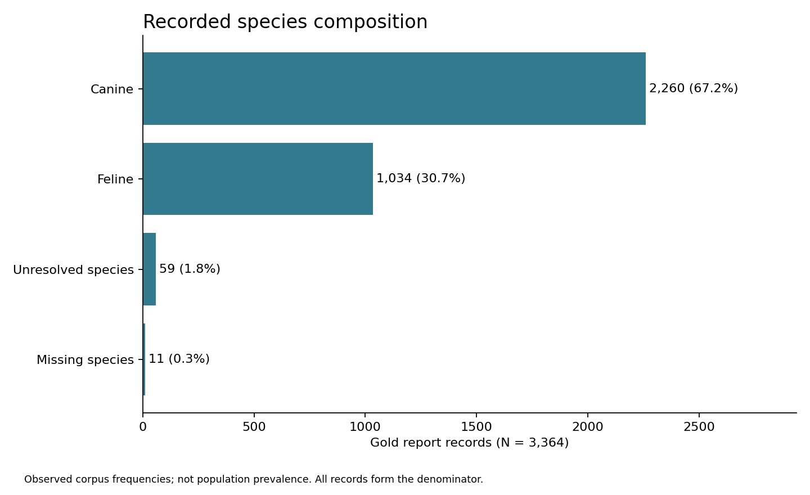
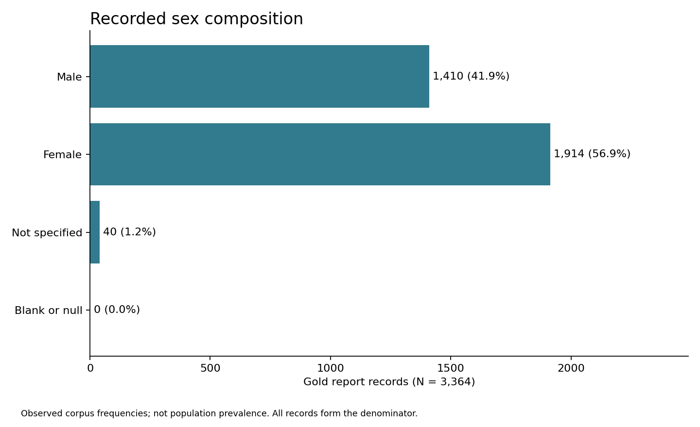

# Echo-Vet-Analysis

Python and Jupyter workflows for describing a private corpus of veterinary ultrasound reports while keeping original reports and individual clinical data private.

**Public repository. Original code is distributed under the [MIT License](LICENSE), copyright (c) 2026 Ives Cáceres.**

## Real descriptive results

The exact seven-file aggregate editorial bundle is publicly available following hash verification, final review and the owner's separate publication authorization. These results are **REAL_AGGREGATED**: calculated from a real private Gold snapshot, not synthetic demonstrations. They are descriptive corpus statistics, not clinically validated findings or population prevalence estimates.

| Metric | Observed count | Unit |
|---|---:|---|
| Gold report records | 3,364 | Gold record |
| Extraction events | 14,245 | Extraction-event row |

Gold report keys are distinct within the snapshot. Unique animals, independent episodes and content-distinct documents have not been established. Event rows are not independent diagnoses or disease-positive reports.

| Species coding | Records | Percentage |
|---|---:|---:|
| Canine | 2,260 | 67.2% |
| Feline | 1,034 | 30.7% |
| Unresolved species | 59 | 1.8% |
| Missing species | 11 | 0.3% |

| Sex coding | Records | Percentage |
|---|---:|---:|
| Male | 1,410 | 41.9% |
| Female | 1,914 | 56.9% |
| Not specified | 40 | 1.2% |
| Blank or null | 0 | 0.0% |

Both distributions use all **3,364** Gold records, including missing/unresolved codes. Percentages are rounded to one decimal. The 40 Not specified records match predefined non-specification codes; none was imputed as male or female. Unresolved species does not assert another confirmed species.




Read the exact [methods, results and limitations](published/editorial/results.md), [volume table](published/editorial/tables/corpus_volume.csv), [species table](published/editorial/tables/species.csv), [sex table](published/editorial/tables/sex.csv) and [field-presence table](published/editorial/tables/field_coverage.csv). Field presence means non-null/nonblank, not clinical completeness or validity. Each field has denominator 3,364; marginal coverages do not establish joint completeness.

## Code and notebooks

Four reviewed analytical workbenches preserve a subset of the original analytical SQL/calculations, with explicit data/output configuration. They are not a complete extraction pipeline or proof of equivalence to every original private analysis.

| Notebook | Purpose |
|---|---|
| 00_gold_v2_inventory.ipynb | Structure and integrity profiling |
| 01_data_quality.ipynb | Missingness and relational quality methods |
| 02_population_demographics.ipynb | Descriptive methods and visualizations |
| 03_event_consistency_audit.ipynb | Event and provenance consistency checks |

Their real-mode outputs can contain individual information and must stay private, outside this checkout. No original outputs, attachments or clinical metadata are retained. Matching Python exports are in `analysis/`.

An auxiliary fifth notebook, `10_reviewed_aggregate_results.ipynb`, displays only synthetic examples or the hash-reviewed aggregate CSV bundle. It has no clinical database connector.

## Installation and offline use

Python 3.11 or later; reviewed runtime versions are listed in `requirements.txt`. No dependency installation is performed by these scripts. Before installing into a separate environment, review the dependency list and third-party notices:

```powershell
python -m venv .venv
.venv\Scripts\python -m pip install -r requirements.txt
```

With existing approved dependencies, run from the repository root:

```powershell
$env:ECHO_MODE = "PUBLIC_DEMO"
$env:ECHO_RESULTS_KIND = "SYNTHETIC_DEMO"
python -B scripts/run_notebook.py notebooks/00_gold_v2_inventory.ipynb
python -B scripts/run_notebook.py notebooks/01_data_quality.ipynb
python -B scripts/run_notebook.py notebooks/02_population_demographics.ipynb
python -B scripts/run_notebook.py notebooks/03_event_consistency_audit.ipynb
python -B scripts/run_notebook.py notebooks/10_reviewed_aggregate_results.ipynb
python -B -m unittest discover -s tests -v
python -B scripts/validate_candidate.py
```

**SYNTHETIC_DEMO** uses entirely invented fixtures, created outside this checkout. Its output is a software demonstration, never a finding about the real corpus. The first four notebooks always use the synthetic database in PUBLIC_DEMO mode.

To inspect the existing reviewed real aggregates without accessing clinical data:

```powershell
$env:ECHO_RESULTS_KIND = "REAL_AGGREGATED"
python -B scripts/run_notebook.py notebooks/10_reviewed_aggregate_results.ipynb
```

The headless runner does not persist outputs and blocks common network/process calls. It is not an operating-system sandbox or a full interactive Jupyter validation. No network service or production credential is required for either demonstration or aggregate viewing.

## Private analysis

PRIVATE_ANALYSIS requires explicit external `ECHO_GOLD_DB`, `ECHO_OUTPUT_ROOT` and `ECHO_EXPECTED_GOLD_SHA256`; the runner also requires `--allow-private`. Inputs use read-only/query-only access, and active sidecars are rejected. There is no automatic database discovery, ingestion, migration or synchronization. Do not save real workbench outputs in this repository. `.env.example` documents configuration names and is not automatically loaded.

No clinical database was queried during this local incorporation. Real statistical reproduction requires separately authorized private inputs, frozen rule versions and methodological review. Synthetic execution cannot reproduce or validate real clinical conclusions.

## Provenance, privacy and limitations

The real tables reuse verified aggregate artifacts from an earlier read-only analysis of a fixed Gold snapshot. The owner confirmed that the responsible veterinarian permits publication of derived aggregate statistics, excluding reports, databases, individual records and identifiable information. This is an owner-confirmed permission, not independent verification of an original agreement or all third-party rights.

Selection/referral patterns, an unverified population sampling frame, repeated animals/episodes, possible content duplicates, unresolved coding and extraction errors limit interpretation. No causal, population-level, diagnostic-accuracy or clinical-validation claim is made. Age/time summaries and their linked denominators, diagnostic frequencies, clinical free text and individual plots are excluded from this editorial release.

The numerical disclosure screen checked cells and complements against a preliminary threshold of 10, alongside linked margins and text/figure consistency. That threshold is not an anonymity guarantee. Historical exposures, external copies and linkage remain possible. The reviewed content is tied to exact file hashes; [editorial-manifest.json](published/editorial-manifest.json) preserves the prepublication local-approval record. Its local-only fields describe that historical review stage, not the current publication status. It is an administrative allowlist, not a digital signature or permission to publish additional content. The owner separately authorized publication of this exact bundle. Any changed artifact must be reviewed again.

See [disclosure policy](docs/DISCLOSURE_POLICY.md), [methods](docs/METHODS.md), [privacy boundaries](docs/PRIVACY.md), [study protocol](docs/STUDY_PROTOCOL.md) and [third-party review](docs/THIRD_PARTY_REVIEW.md). Original reports, RAW/Silver/Gold databases, clinical records, historical Git objects, logs, backups and credentials are not included. The old repository remains separate; no inherited Git history is supplied.

## License and result provenance

See [licensing scope](docs/LICENSING.md), [result provenance](docs/RESULTS_PROVENANCE.md) and [dependency notices](docs/THIRD_PARTY_REVIEW.md). The owner confirmed authorship with Claude assistance and authorized MIT for original software. The software license does not grant rights to clinical inputs, replace third-party licenses or automatically license the editorial statistical assets. Aggregate publication permission remains separately documented.
